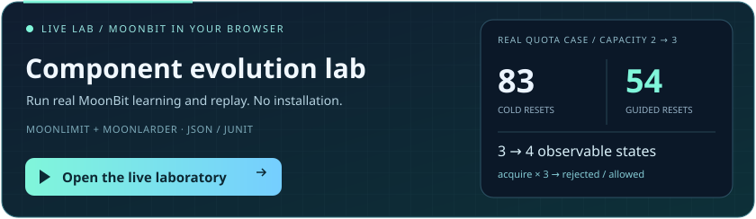
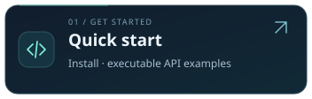
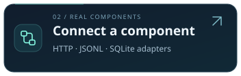
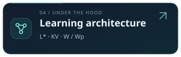
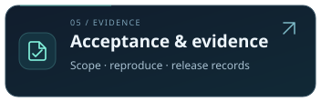
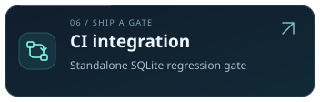

# MoonStateLens

The source and hosted laboratory now include an evidence studio: paired model canvases, trace stepping, actual synchronous learning events, backward compatibility on old-input histories, and integrity-checked replayable experiment bundles. These source additions do not replace the frozen public release. See [the laboratory guide](docs/laboratory.md) for scope and reproduction.


A MoonBit-native active Mealy learner that infers observable states through reset/step experiments and confirms behavioral regressions by replaying distinguishing words on both actual adapters.

Version 0.4 adds history-guided L* relearning with fresh observations, optional binary KV counterexample decomposition, real MoonLimit targets and a browser demo running actual compiled MoonBit code. The fixed 20-pair evolution study records 61.02% median physical reset reduction including Wp verification; AALpy 2.0.0 independently learns and checks the same 20 targets. These finite measurements are not universal speed or adoption claims.

<p align="center">
  <a href="https://captaink-65.github.io/moon-statelens/demo/"></a>
</p>

**Click the card to run your own experiment.** Configure old/new quota capacities and query budgets, compare your own model JSON, inspect existing execution reports, or generate JSONL configurations and a GitHub Actions gate for your repository. Files are read locally in your browser. The default real-component case still produces **3→4 states and 83→54 resets**; these are scenario-specific counts. Token-bucket/LRU presets and JSON/JUnit downloads remain available. See the [laboratory guide and evidence boundaries](docs/laboratory.md).

<!-- Keep navigation compatible with GitHub's Markdown renderer; no custom CSS or embedded SVG links. -->
<p align="center">
  <a href="README.mbt.md"></a>
  <a href="docs/native.md"></a>
  <a href="docs/evolution.md"></a>
  <a href="docs/architecture.md"></a>
  <a href="docs/ACCEPTANCE.md"></a>
  <a href="consumers/sqlite-gate/README.md"></a>
</p>
<p align="center">
  <a href="README.md"></a>
  <a href="https://mooncakes.io/docs/CaptainK-65/moon-statelens"></a>
  <a href="docs/independent-core.md"></a>
  <a href="docs/maintainer-notes.md"></a>
</p>

The root library supports wasm, wasm-gc, JS and native. Version 0.2 adds independent L* and KV learners, W/Wp and composed verification, resumable query execution, and native asynchronous HTTP, JSONL subprocess and real SQLite CLI adapters. Systems remain deterministic, resettable and finite under an explicit abstraction. See [native integration](docs/native.md) and [algorithm invariants](docs/algorithms.md).

Version 0.3 adds finite input/output safety monitors with fresh target confirmation,
saved model-derived state/transition/W/Wp regression suites, prefix-sharing certificates
preserving every original assertion, multiple freshly replayed differing contexts,
an offline interactive evidence viewer and JUnit output. Rules can detect defects
shared by both versions; regression execution does not require relearning the target.

Fixed-corpus results: 60 new minimal/reachable targets up to 64 states, 120 correct
learning runs across both algorithms, 1,080 behaviorally inequivalent controlled
mutants detected with identical original case failures before/after compaction.
Across 30 small models and complete W/Wp passing suites, 1,183 original cases are
preserved and median physical resets decrease 62.5%, with the same independent
fresh stability rechecks. These are finite reproducible measurements, not universal
performance/detection claims. Run `moon run tools/verify_v03.mbtx`; see the
[measurement scope and new workflows](docs/behavior-validation.md).

## Run

For the portable core, run `moon update`, `moon test --target wasm` and
`moon run examples/session`; SQLite is not needed. Follow the
[tested library API example](README.mbt.md) to embed the package.

For native integration, install SQLite and build the fixture executables first:

```sh
moon update
sqlite3 --version
moon build --target native --deny-warn
moon run cmd/statelens --target native -- validate-config configs/sqlite-kv.json
moon test --target all --deny-warn
moon run examples/session
moon run examples/regression
moon run examples/lru
moon run cmd/statelens --target native -- demo regression
moon run tools/verify_cli.mbtx
moon run cmd/statelens --target native -- run-config configs/sqlite-kv.json
moon run tools/verify_native.mbtx
```

CI pins compiler/core 0.10.18+6c83a7f62 / moon 0.1.20261028. Native tests require SQLite on PATH and built fixture executables. Install the package with `moon add CaptainK-65/moon-statelens@0.5.0`, then import `"CaptainK-65/moon-statelens" @lens` in your package. Portable core-only tests can use the wasm backend.

Version 0.2.2 adds offline target validation and persisted comparison/replay
evidence. `validate-config CONFIG [run|compare|replay]` checks structure and
operation semantics without starting targets or contacting servers. It does not
prove availability, filesystem permissions, reset reliability or state bounds.
Run `moon update` once to bootstrap a fresh registry, then
`moon run tools/verify_acceptance.mbtx` from the repository root for source
acceptance. This saves actual environment, command exits, logs and summaries;
verification of an explicitly selected public package version is separate.

Configuration commands use exits 0 (evidence policy met), 1 (execution error),
2 (freshly confirmed difference), 3 (insufficient/unstable evidence). Comparison
reports are common to both sides; configured models/DOT/traces belong to their
side. Replay supports report/traces only. Outputs use exclusive creation, need
existing parent directories, and must have distinct paths. Failed writes are
execution failures, and multiple output files are not an atomic transaction.
See the full [native configuration and artifact contract](docs/native.md).

## Independent core

Observation-table L*, classification-tree KV, suffix observations, hypothesis construction, counterexample refinement, bounded conformance experiments, minimization and shortest distinguishing sequences are implemented here. Standard collections and JSON are reused. Async IO serves native runners/adapters and the CLI. MoonLarder and SQLite are real systems under learning, not inference engines.

The real LRU adapter learns a ten-state observable abstraction: capacity two, three fixed keys, values equal to keys, no TTL, and hidden statistics. Session fixtures demonstrate a replay-confirmed login/logout/request regression. They do not allege a third-party vulnerability.

## Evidence scopes

- `confirmed-difference`: reproduced outputs differ on the actual adapters.
- `no-difference-between-hypotheses`: learned models agree, subject to both learning results' evidence.
- `exact-reference`: equivalence to the supplied explicit model; the caller establishes adapter correspondence.
- `conditional-state-bound`: complete W/Wp execution under the stated bound and deterministic, total, resettable Mealy assumptions.
- `budgeted`: no counterexample found in the completed finite experiment.
- `inconclusive`: a budget or prerequisite prevented completion.
- `unstable` or `unstable-during-replay`: inconsistent observations, with the conflicting trace retained.

Observed conflicts invalidate the session. Cache bypass and periodic checks provide evidence of stability, not proof of determinism. Output abstraction is explicit and may hide differences. Async IO does not add learning of concurrent interleavings, stochastic/timed models or infinite data domains.

## Validation

The suite includes 200 generated targets, delayed distinguishing suffixes, independent reverse-pair/BFS cross-checks, mutation witnesses, real-library integration, replay and resource boundaries. CI checks all four library backends on Linux, Windows and macOS, plus the native CLI.

Generated corpora and mutation studies are cases inside named tests,
not tens of thousands of individually named tests. Actual frozen-commit CI and
publication results are linked in the [validation record](docs/VALIDATION.md).

`benchmark` emits a deterministic [query-cost reference study](docs/evidence/query-study.json). Active costs include learning and W-method testing; exhaustive validation receives the final model. It is not a like-for-like learner speedup claim.

[LearnLib](https://learnlib.de/) and [AALpy](https://github.com/DES-Lab/AALpy) are related implementations in other languages, not runtime dependencies. This is an independent implementation of published research, not a claim to invent active learning. See [provenance](THIRD_PARTY_NOTICES.md), [ecosystem audit](docs/ecosystem-audit.md) and [LICENSE](LICENSE).
