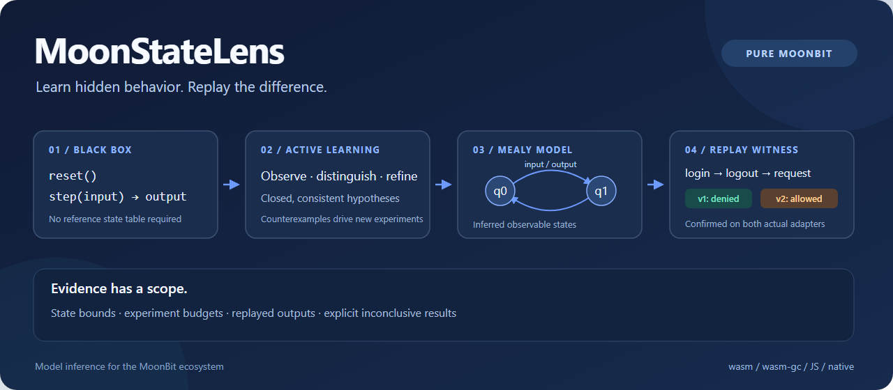

# MoonStateLens

[](https://github.com/CaptainK-65/moon-statelens/actions/workflows/ci.yml) [](LICENSE)

[English](README.en.md) · [可执行快速开始](README.mbt.md) · [使用指南](docs/guide.md) · [独立核心说明](docs/independent-core.md)



**通过黑盒交互推导行为模型，再把版本差异回放到真实目标。**

MoonStateLens 是纯 MoonBit 编写的主动 Mealy 自动机学习内核。调用方提供有限操作集合与 `reset/step` 适配器，学习器主动设计实验，区分隐藏的可观察状态，通过反例修正模型，并生成可审查的状态图与回归轨迹。

核心库支持 wasm、wasm-gc、JS、native；文件操作 CLI 使用 native。首版支持同步、进程内适配器。

## 三个可运行场景

```sh
moon update
moon run examples/session
moon run examples/regression
moon run examples/lru
```

| 场景 | 真实交付 |
| --- | --- |
| 会话学习 | 仅调用登录／退出／请求接口，推导两状态模型，无需提供状态表 |
| 版本回归 | 找出 `login → logout → request`，在两个实际适配器上确认 `denied / allowed` 差异 |
| 现有组件接入 | 只调用 `jhshuai/moonlarder@0.15.0` 公开 API，学习容量 2、三个固定键、无 TTL 的 10 状态 LRU 行为 |

会话缺陷是有意编写的受控样例，不代表第三方 SDK 存在漏洞。MoonLarder 是真实依赖与被测对象，学习器不读取它的内部状态。完整边界见 [适配与证据说明](docs/guide.md)。

## 快速验证

已验证工具链：MoonBit 0.10.15，moon 0.1.20261012。推荐使用当前稳定版。

```sh
git clone https://github.com/CaptainK-65/moon-statelens.git
cd moon-statelens
moon update
moon check --target all --deny-warn
moon build --target all --deny-warn
moon test --target all --deny-warn
moon run cmd/statelens --target native -- demo regression
moon run tools/verify_cli.mbtx
```

安装发布包的方式：

```sh
moon add CaptainK-65/moon-statelens@0.1.0
```

消费包中加入：

```moonbit
import {
  "CaptainK-65/moon-statelens" @lens,
}
```

[可执行快速开始](README.mbt.md) 给出完整的 `System::new → Experiment::new → learn` 示例。核心包仅导入 MoonBit 标准库；整个模块还包含 CLI 的 async 依赖与真实组件适配依赖，不宣称整个模块零依赖。

## 核心能力

- **观测表学习**：Mealy L* 变体，闭合性、一致性、区分后缀与反例前缀修正。
- **受控实验**：重置／执行／清理、前缀轨迹缓存、绕过缓存复测、冲突失效，以及查询、步数、输出量和表存储预算。
- **一致性策略**：显式参考模型、深度枚举、固定种子随机词、带状态上界的 W-method。
- **模型分析**：可达状态、最小化、最短模型区分词、一次反向状态对搜索构造区分后缀。
- **兼容性验证**：真实回放确认差异；未复现的模型分歧进入新一轮学习。
- **交付证据**：版本化 JSON、DOT 图、逐轮统计、反例与可复现查询成本报告。

核心源码位于仓库根目录；`adapters/`、`examples/`、`benchmarks/` 和 `cmd/` 分别是实际组件接入、消费者、成本实验与 CLI。[架构说明](docs/architecture.md) 对应每项职责及不变量。

## 结果如何解读

| 结果 | 含义 |
| --- | --- |
| `confirmed-difference` | 区分序列已经在两个实际目标上回放，输出不同 |
| `no-difference-between-hypotheses` | 当前两个模型一致；结论仍受双方学习证据约束 |
| `exact-reference` | 与给定完整参考模型等价；适配器确实实现该参考模型是调用方前提 |
| `conditional-state-bound` | 在声明的状态上界、确定性、完整输入和可靠重置等前提下完成 W-method |
| `budgeted` | 已完成所述有限实验，未找到反例 |
| `inconclusive` | 预算或条件不足，保留最后一个完整假设（如有） |
| `unstable`／`unstable-during-replay` | 观察到冲突；报告轨迹，受影响会话停止使用旧缓存 |

首版不支持非确定／概率／带时钟自动机、并发交错、无限参数推断或直接异步网络适配。输出抽象由调用方显式定义，可能掩盖被忽略的差异。有限次稳定观察不能证明目标永远确定。

## CLI

```sh
moon run cmd/statelens --target native -- --help
moon run cmd/statelens --target native -- learn fixtures/session.json 2
moon run cmd/statelens --target native -- compare fixtures/session.json fixtures/session-buggy.json
moon run cmd/statelens --target native -- replay fixtures/session.json fixtures/session-regression-inputs.json
moon run cmd/statelens --target native -- dot fixtures/session.json
moon run cmd/statelens --target native -- benchmark
```

`learn MODEL.json` 用模型包装出的黑盒进行可重复实验；接入真实组件使用嵌入式 API 或 `demo lru`。导出命令拒绝覆盖已有文件。退出码 0 表示命令产生了有效报告，自动化仍须检查报告的 `status.kind`。

## 验证与成本证据

测试包含 200 个固定种子的生成目标（1—20 状态）、长后缀状态区分、40 个模型的独立区分后缀交叉检查、变异见证、真实 LRU 接入、回放与资源边界。CI 在 Linux、Windows、macOS 上执行检查、构建、四后端测试及 CLI 烟测。

[查询成本报告](docs/evidence/query-study.json) 公开所有计数。7 状态样例的学习加 W-method 使用 351 次重置、2089 次操作；给定最终模型后的深度枚举验证使用 16383 次重置、196610 次操作。2 状态样例中主动流程调用反而更多。两者工作不同，这是一组成本参照，不能外推为通用提速倍数。

```sh
moon run tools/update_evidence.mbtx
moon run tools/verify_cli.mbtx
moon fmt --check
moon info
```

## 来源与非重叠说明

本项目基于公开自动机学习研究独立实现。[LearnLib](https://learnlib.de/) 与 [AALpy](https://github.com/DES-Lab/AALpy) 是其他语言的相关实现，不是运行时引擎；没有复制其源码，不声称算法全球首创。

2026-10-16 的 Mooncakes／GitHub 查重及近邻职责比较见 [调研记录](docs/ecosystem-audit.md)。已有 MoonBit 状态测试工具需要预先提供模型；本项目新增从交互推导模型的核心算法。未检出同职责实现不等于全网不存在，也不保证赛事审核结果。

[第三方来源](THIRD_PARTY_NOTICES.md) · [贡献说明](CONTRIBUTING.md) · [安全与使用边界](SECURITY.md) · [Apache-2.0](LICENSE)
