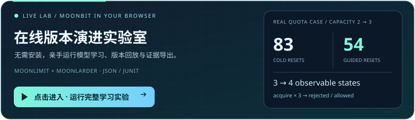
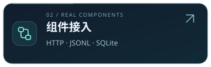
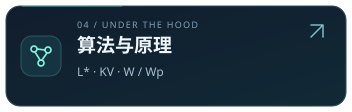

# MoonStateLens

[](https://github.com/CaptainK-65/moon-statelens/actions/workflows/ci.yml) [](LICENSE)


**通过黑盒交互推导行为模型，再把版本差异回放到真实目标。**

**v0.4 版本演进**：历史模型引导 L* 重新学习、二分 KV 反例处理，以及真实限流/配额组件案例。

源码与在线实验室新增 **行为演进工作台**：新旧模型对照、轨迹逐步回放、真实学习事件审查、定向兼容判定和完整实验包导入／复现。新增接口保留旧操作历史时可单独判定兼容；实验包内容校验与真实执行认证明确区分。使用方法见实验室指南，已发布版本的冻结记录保留。

<p align="center">
  <a href="https://captaink-65.github.io/moon-statelens/demo/"></a>
</p>

**点击卡片，开始自己的实验**：调整新旧配额容量和查询预算，运行真实 MoonBit 学习与回放；导入自己的模型 JSON 进行精确比较，或查看已有执行报告；通过接入向导生成真实组件配置与 GitHub Actions 工作流。文件在浏览器本地读取。默认配额案例仍可复现 **3→4 状态、83→54 次重置**，数字仅对应该场景。完整组件示例包含令牌桶和 LRU，支持 JSON/JUnit 下载。[使用指南与接入边界](docs/laboratory.md)。

<!-- Navigation uses ordinary links around local SVGs so GitHub renders the entire card as a link. -->
<p align="center">
  <a href="README.mbt.md"></a>
  <a href="docs/native.md"></a>
  <a href="docs/evolution.md"></a>
  <a href="docs/algorithms.md"></a>
  <a href="docs/ACCEPTANCE.md"></a>
  <a href="consumers/sqlite-gate/README.md"></a>
</p>
<p align="center">
  <a href="README.en.md"></a>
  <a href="https://mooncakes.io/docs/CaptainK-65/moon-statelens"></a>
  <a href="docs/independent-core.md"></a>
  <a href="docs/maintainer-notes.md"></a>
</p>

MoonStateLens 是纯 MoonBit 编写的主动 Mealy 自动机学习内核。调用方提供有限操作集合与 `reset/step` 适配器，学习器主动设计实验，区分隐藏的可观察状态，通过反例修正模型，并生成可审查的状态图与回归轨迹。

v0.2 提供 L* 与 KV 两种学习器、W/Wp 验证及策略链。核心库支持 wasm、wasm-gc、JS、native；native 执行器接入异步 HTTP、JSONL 子进程和真实 SQLite CLI，保留原同步接口。

v0.3 增加有限行为规则检查、可保存的模型回归测试集、保留全部原始断言的前缀压缩、多个差异上下文的真实确认，以及离线交互报告与 JUnit。首次使用可按目标选择：

| 目标 | 入口与预期 |
| --- | --- |
| 先看模型学习，不安装 SQLite | `moon update` 后执行 `moon run examples/session`，输出从接口交互学得的会话模型 |
| 在自己的 MoonBit 项目使用核心库 | [可执行 API 示例](README.mbt.md)，便携核心测试使用 `moon test --target wasm` |
| 学习真实 SQLite 或接入进程／HTTP | 先安装 SQLite 并构建 native，按下方命令及 [完整说明](docs/native.md) 操作 |
| 复现最终源码验收 | 首次先 `moon update`，再 `moon run tools/verify_acceptance.mbtx`，实际运行检查、构建、测试和演示并保存日志 |
| 复现 v0.3 新增能力与量化实验 | `moon run tools/verify_v03.mbtx`，实际运行规则／回归／诊断及三组固定实验 |

**固定语料实测**：新增 60 个可达且最小的学习目标，双算法共 120 次正确运行，最大 64 状态；1,080 个行为不等价的受控变异全部检出；压缩前后原始失败断言一致。在 30 个小模型的 W/Wp 正常完整执行中，保留 1,183 个原始 case，物理重置次数中位数减少 **62.5%**（双方都保留独立稳定性复测）。这些数字不是任意组件的性能或缺陷检出保证，[完整口径与复现](docs/behavior-validation.md#量化口径)。

```sh
moon update
sqlite3 --version
moon build --target native --deny-warn
moon run cmd/statelens --target native -- validate-config configs/sqlite-kv.json
moon run cmd/statelens --target native -- run-config configs/sqlite-kv.json
moon run cmd/statelens --target native -- run-config configs/session-jsonl.json
moon run tools/verify_native.mbtx
```

SQLite 限定单条记录与有限事务操作，通过实际 CLI 学习六状态行为；独立参考模型仅在学习结束后用于测试。HTTP 与协议缺陷案例属于受控夹具。[完整接入与复现步骤](docs/native.md) 包含依赖、配置、退出码及异常边界。

## 三个可运行场景

```sh
moon update
moon run examples/session
moon run examples/regression
moon run examples/lru
```

| 场景 | 真实交付 |
| --- | --- |
| 会话学习 | 仅调用登录／退出／请求接口，推导两状态模型，无需提供状态表 |
| 版本回归 | 找出 `login → logout → request`，在两个实际适配器上确认 `denied / allowed` 差异 |
| 现有组件接入 | 只调用 `jhshuai/moonlarder@0.15.0` 公开 API，学习容量 2、三个固定键、无 TTL 的 10 状态 LRU 行为 |

会话缺陷是有意编写的受控样例，不代表第三方 SDK 存在漏洞。MoonLarder 是真实依赖与被测对象，学习器不读取它的内部状态。完整边界见 [适配与证据说明](docs/guide.md)。

## 快速验证

验收工具链：MoonBit/compiler/core `0.10.15+943464bfa`，moon `0.1.20261012`，CI 固定该版本。native 集成测试需先构建夹具，并确保 `sqlite3` 位于 PATH；仅测试便携核心可用 `moon test --target wasm`。

```sh
git clone https://github.com/CaptainK-65/moon-statelens.git
cd moon-statelens
moon update
moon check --target all --deny-warn
moon build --target all --deny-warn
moon test --target all --deny-warn
moon run cmd/statelens --target native -- demo regression
moon run tools/verify_cli.mbtx
```

安装发布包的方式：

```sh
moon add CaptainK-65/moon-statelens@0.4.0
```

消费包中加入：

```moonbit
import {
  "CaptainK-65/moon-statelens" @lens,
}
```

[可执行快速开始](README.mbt.md) 给出完整的 `System::new → Experiment::new → learn` 示例。核心包仅导入 MoonBit 标准库；整个模块还包含 CLI 的 async 依赖与真实组件适配依赖，不宣称整个模块零依赖。

## 核心能力

- **两种学习算法**：Mealy L* 观测表与独立 KV 区分树，共享可暂停的查询驱动。
- **受控实验**：重置／执行／清理、前缀轨迹缓存、绕过缓存复测、冲突失效，以及查询、步数、输出量和表存储预算。
- **一致性策略**：显式参考模型、深度枚举、固定种子随机词、W/Wp-method，以及历史反例重放和策略链。
- **实际组件接入**：同步回调、异步 HTTP、JSONL 子进程、SQLite 专用映射；超时、取消和受管进程回收。
- **模型分析**：可达状态、最小化、最短模型区分词、一次反向状态对搜索构造区分后缀。
- **兼容性验证**：真实回放确认差异；未复现的模型分歧进入新一轮学习。
- **交付证据**：版本化 JSON、DOT 图、逐轮统计、反例与可复现查询成本报告。
- **模型回归**：状态／迁移覆盖、W/Wp 套件导出与实际执行；前缀证书逐一保留原始断言，生成或执行不完整不会通过门禁。
- **有限行为规则**：始终禁用、触发后禁用、直到成功事件才解除；模型反例需在实际组件上重新确认，可发现两版共有的缺陷。
- **多差异审查**：按共同输入历史分析模型乘积图，在双方实际目标上确认每个差异上下文；离线筛选、逐步回放视图、模型图和 JUnit。

核心源码位于仓库根目录；`adapters/`、`examples/`、`benchmarks/` 和 `cmd/` 分别是实际组件接入、消费者、成本实验与 CLI。[架构说明](docs/architecture.md) 对应每项职责及不变量。

## 结果如何解读

| 结果 | 含义 |
| --- | --- |
| `confirmed-difference` | 区分序列已经在两个实际目标上回放，输出不同 |
| `no-difference-between-hypotheses` | 当前两个模型一致；结论仍受双方学习证据约束 |
| `exact-reference` | 与给定完整参考模型等价；适配器确实实现该参考模型是调用方前提 |
| `conditional-state-bound` | 在声明的状态上界、确定性、完整输入和可靠重置等前提下完成 W/Wp-method |
| `budgeted` | 已完成所述有限实验，未找到反例 |
| `inconclusive` | 预算或条件不足，保留最后一个完整假设（如有） |
| `unstable`／`unstable-during-replay` | 观察到冲突；报告轨迹，受影响会话停止使用旧缓存 |

不支持非确定／概率／带时钟自动机、并发交错或无限参数推断。异步 IO 仍按顺序操作目标；输出抽象由调用方显式定义，可能掩盖被忽略的差异。有限次稳定观察不能证明目标永远确定。

## CLI

```sh
moon run cmd/statelens --target native -- --help
moon run cmd/statelens --target native -- learn fixtures/session.json 2
moon run cmd/statelens --target native -- compare fixtures/session.json fixtures/session-buggy.json
moon run cmd/statelens --target native -- replay fixtures/session.json fixtures/session-regression-inputs.json
moon run cmd/statelens --target native -- dot fixtures/session.json
moon run cmd/statelens --target native -- benchmark
```

`learn MODEL.json` 用模型包装出的黑盒进行可重复实验；真实组件可使用 `run-config`、`compare-config`、`replay-config` 或嵌入式 API。旧命令退出码 0 表示有效报告，仍须检查状态。新配置命令按证据要求返回：0 满足条件、1 执行错误、2 真实确认差异、3 证据不足或不稳定。导出拒绝覆盖已有文件。

`validate-config CONFIG.json [run|compare|replay]` 在不启动目标、不发 HTTP 请求的情况下检查配置；它不验证目标可用性、重置可靠性或状态上界。学习、比较分别导出各自报告与模型；比较的模型／轨迹按配置所属一侧保存。回放只支持报告和轨迹，配置模型／DOT 会提前报错。各产物目的路径须唯一且父目录已存在，具体规则见 [产物约定](docs/native.md#artifacts-and-reports)。

## 验证与成本证据

测试包含 200 个固定种子的生成目标（1—20 状态）、两种学习器对全部 256 个二状态二输入二输出表的核验、Wp 对 65,536 个模型对的独立精确比较，以及长后缀、40 个模型区分后缀交叉检查、真实 LRU／SQLite、异步取消和协议故障。上述语料不是分别命名的数万项测试。平台与发布结果以 [验收记录](docs/VALIDATION.md) 为准。

[查询成本报告](docs/evidence/query-study.json) 公开所有计数。7 状态样例的学习加 W-method 使用 351 次重置、2089 次操作；给定最终模型后的深度枚举验证使用 16383 次重置、196610 次操作。2 状态样例中主动流程调用反而更多。两者工作不同，这是一组成本参照，不能外推为通用提速倍数。

```sh
moon run tools/update_evidence.mbtx
moon run tools/verify_cli.mbtx
moon fmt --check
moon info
```

## 来源说明

本项目基于公开自动机学习研究独立实现。

[第三方来源](THIRD_PARTY_NOTICES.md) · [贡献说明](CONTRIBUTING.md) · [安全与使用边界](SECURITY.md) · [Apache-2.0](LICENSE)
